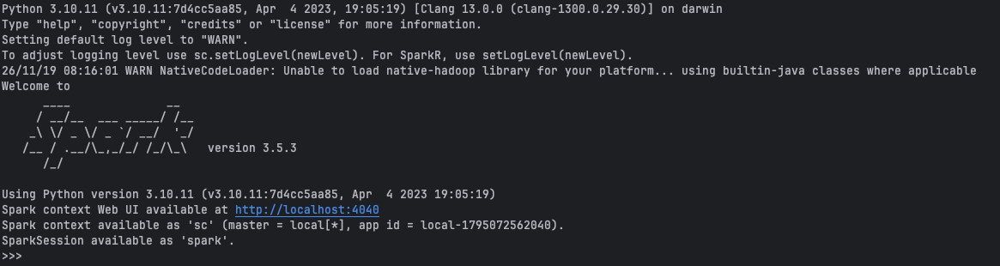

# PySpark lab: exploring IoT sensor data

## Example 0
This is the original example from https://spark.apache.org/.
However, reading the CSV will map the 'AccountBalance' field to a string, causing the analysis to fail.
The code below provides a custom schema when reading.

```python
from pyspark.sql.types import StructType, StructField, IntegerType, StringType, DoubleType, BooleanType

# 1. Define the schema
schema = StructType([
    StructField("AccountID", StringType(), nullable=False),
    StructField("AccountType", StringType(), nullable=False),
    StructField("AccountBalance", DoubleType(), nullable=False),
    StructField("CountOfDependents", IntegerType(), nullable=False),
    StructField("CreditScore", IntegerType(), nullable=False),
    StructField("IsActive", BooleanType(), nullable=False)
])

df = (
    spark.read
    .option("header", "true")  # Skip the first row if your CSV has headers
    .schema(schema)
    .csv("/accounts.csv")
)

df.printSchema()


# Select subset of features and filter for balance > 0
filtered_df = df.select("AccountBalance", "CountOfDependents").filter("AccountBalance > 0")

# Generate summary statistics
filtered_df.summary().show()
```


## Context and goal

In the previous labs, we collected IoT readings and considered how to store and query them with different NoSQL models. This exercise looks at a different question: **how can we process a collection of stored readings to produce an analytical result?**

We will use PySpark DataFrames to read JSON Lines, select and filter measurements, calculate summaries, express a query in Spark SQL, and save the result as Parquet. The final Parquet dataset can be read again by Spark or explored with DuckDB. The example file has only six readings: it helps us understand the operations, but it cannot demonstrate a performance advantage from distributed processing.

The sections build on one another. Run the setup first, then execute the examples in order in a PySpark shell or notebook. Paths are relative to the project directory.

```text
project/
├── examples/
│   └── device_data-example.jsonl
└── output/                        # Created when we write the result
```

Each line of `device_data-example.jsonl` contains one reading, including `device_id`, `collected_at_tz`, and a nested `sensors` object. Spark reads these JSON Lines into a DataFrame and infers a schema. The text in `collected_at_tz` has no explicit timezone offset; this lab uses its displayed date and time without claiming a verified timezone.


## 1. Check the prerequisites

- **Python 3.11 or newer**. Install it from [python.org](https://www.python.org/downloads/) if needed.
- **Java 17** (JDK). It works with both Spark 3.5 and Spark 4.x. Install it only if you do not already have a compatible JDK.
- An internet connection for the initial package installation.

The instructions below install the current PySpark release. If the course project specifies a Spark version, install the matching PySpark version instead (for example, `pyspark==3.5.8`) and check that your Python and Java versions meet its requirements. Run all commands from a terminal opened **in the project directory**. Later, this directory must contain `examples/device_data-example.jsonl` for the IoT exercises.

### macOS (Terminal)

Check your installations:

```bash
python3 --version
java -version
```

If you need Java 17 and already use Homebrew, install it and point `JAVA_HOME` to it in the terminal used for this lab:

```bash
brew install openjdk@17
export JAVA_HOME="$(brew --prefix openjdk@17)/libexec/openjdk.jdk/Contents/Home"
"$JAVA_HOME/bin/java" -version
```

Create an isolated Python environment, install the packages, register its Jupyter kernel, and start JupyterLab:

```bash
python -m pip install pyspark
```

If Java 17 is already installed, you can skip `brew install`; ensure that Java is available to the terminal starting Jupyter. To use a specific course version, replace `pyspark` in the `pip install` command with `pyspark==VERSION`.

### Windows (PowerShell)

Check your installations:

```powershell
py -3 --version
java -version
```

If `java` is not recognized, install a [Java 17 JDK for Windows](https://learn.microsoft.com/en-us/java/openjdk/download), set `JAVA_HOME` to the JDK installation directory and add `%JAVA_HOME%\bin` to `Path`. Close and reopen PowerShell, then repeat `java -version`. If `py` is not recognized, install Python from [python.org](https://www.python.org/downloads/) and reopen PowerShell.


## Start a Spark session

Execute the pyspark command from the current directory:

```
pyspark
```

The result must be an interface like this:



### Optional warm-up: select, filter, summarize

This independent example uses `examples/accounts.csv` **only if that separate file was provided**. It selects two columns, keeps accounts with a positive balance, and displays summary statistics. It introduces the same DataFrame operations that we will apply to the IoT readings. Skip it if you only have the IoT file.

```python
accounts = spark.read.csv("examples/accounts.csv", header=True, inferSchema=True)

filtered_accounts = (
    accounts.select("AccountBalance", "CountOfDependents")
    .filter(col("AccountBalance") > 0)
)

filtered_accounts.summary().show()
```

## Load the IoT readings

First import the required dependencies:

```python
from pyspark.sql import SparkSession
from pyspark.sql.functions import (
    avg,
    col,
    count,
    max,
    min,
    regexp_replace,
    round,
    to_timestamp,
)
````

Read the JSON Lines file once and reuse the resulting DataFrame in the examples below. `printSchema()` reveals that the measurement fields are inside the `sensors` structure.

```python
df = spark.read.json("examples/device_data-example.jsonl")
df.printSchema()
```

### Example 1 — Select a column

`select()` keeps only `device_id` and `show()` displays the result. Each output row still represents a reading: if a device has several readings, its identifier can appear several times. Use `distinct()` only when you specifically want a list of unique devices.

```python
devices = df.select("device_id")
devices.show()
```

### Example 2 — Filter one device

`filter()` keeps only readings whose `device_id` matches `TeamLab-02`. This is the basic pattern for inspecting one sensor's history. In our small sample there is one matching reading.

```python
dev1 = df.filter(col("device_id") == "TeamLab-02")
dev1.show()
```

### Example 3 — Filter several devices

`isin()` selects readings from either `AB1-02` or `AA1-02`. Unlike the previous example, a single condition can name several devices without repeating the comparison.

```python
rooms = ["AB1-02", "AA1-02"]
df_rooms = df.filter(col("device_id").isin(rooms))
df_rooms.show()
```

These identifiers name **devices** in the data. A verified physical location would require the topology information used in the earlier lab.

### Example 4 — Filter a nested measurement

`sensors.co2` accesses the `co2` field inside the nested `sensors` object. The filter keeps readings above 500. With the provided six-row file, this returns the reading from `B1-01`.

```python
df_co2_high = df.filter(col("sensors.co2") > 500)
df_co2_high.show()
```

### Example 5 — Combine conditions

The `&` operator requires **all three** conditions to be true: the device is `TeamLab-02`, CO₂ exceeds 400, and temperature exceeds 22.0. Parentheses around each comparison are required when combining Spark column expressions.

```python
df_warning = df.filter(
    (col("device_id") == "TeamLab-02")
    & (col("sensors.co2") > 400)
    & (col("sensors.temperature") > 22.0)
)
df_warning.show()
```

The thresholds here are **exercise conditions**, not an operational air-quality alert policy.

### Example 6 — Work with a time window

`to_timestamp()` converts the time string into a Spark timestamp column. The filter selects readings from 23:00 on 31 October up to, but not including, midnight. All six supplied readings fall within this interval, so this example illustrates the syntax rather than a selective result.

```python
df_temp = df.withColumn("timestamp", to_timestamp(col("collected_at_tz")))

df_evening = df_temp.filter(
    (col("timestamp") >= "2025-10-31 23:00:00")
    & (col("timestamp") < "2025-11-01 00:00:00")
)
df_evening.show()
```

### Example 7 — Aggregate by device

`groupBy()` collects readings for the same device into one group. `agg()` then calculates its mean and highest CO₂ reading, together with mean temperature. Because the sample contains only one reading per device, each mean currently equals that reading's value; multiple readings per device would make the aggregation more informative.

```python
df_stats = df.groupBy("device_id").agg(
    avg("sensors.co2").alias("mean_co2"),
    max("sensors.co2").alias("highest_co2"),
    avg("sensors.temperature").alias("mean_temperature"),
)
df_stats.show()
```

### Example 8 — Query nested data with Spark SQL

`createOrReplaceTempView()` gives the DataFrame a name for SQL queries in the current Spark session. This query selects the time and two nested measurements, filters CO₂ readings above 500, and sorts them from highest to lowest. It expresses the same kind of selection as Example 4 using SQL.

```python
df.createOrReplaceTempView("readings")

spark.sql("""
    SELECT device_id, collected_at_tz, sensors.co2, sensors.temperature
    FROM readings
    WHERE sensors.co2 > 500
    ORDER BY sensors.co2 DESC
""").show()
```

### Example 9 — Flatten the sensor structure

`sensors.*` selects every field from the nested `sensors` object as a top-level column. The resulting table has columns such as `co2`, `temperature`, and `humidity`, which are easier to use in aggregations and downstream analysis. `printSchema()` lets you compare the flattened schema with the original one.

```python
df_flat = df.select(
    col("device_id"),
    col("collected_at_tz"),
    col("sensors.*"),
)

df_flat.printSchema()
df_flat.show(5)
```

### Example 10 — Summarize with the DataFrame API

Starting from `df_flat`, this aggregation counts readings per device and calculates CO₂ and temperature statistics. The aliases name the output columns. `show()` triggers execution and displays the resulting summary.

```python
df_stats_api = df_flat.groupBy("device_id").agg(
    count("*").alias("total_readings"),
    round(avg("co2"), 2).alias("mean_co2"),
    max("co2").alias("max_co2"),
    min("co2").alias("min_co2"),
    round(avg("temperature"), 2).alias("mean_temperature"),
)

df_stats_api.show()
```

### Example 11 — Write the equivalent summary in Spark SQL

Create a temporary view from the flattened data and compute the same statistics in SQL. Compare its values with Example 10: the DataFrame API and SQL express the same analysis, while this query also sorts devices by mean CO₂.

```python
df_flat.createOrReplaceTempView("sensors_flat")

df_stats_sql = spark.sql("""
    SELECT
        device_id,
        COUNT(*) AS total_readings,
        ROUND(AVG(co2), 2) AS mean_co2,
        MAX(co2) AS max_co2,
        MIN(co2) AS min_co2,
        ROUND(AVG(temperature), 2) AS mean_temperature
    FROM sensors_flat
    GROUP BY device_id
    ORDER BY mean_co2 DESC
""")

df_stats_sql.show()
```

### Example 12 — Save to Parquet and read the result back

`write.parquet()` saves the summary in a **directory** containing one or more Parquet part files; the path is not the name of a single Parquet file. `mode("overwrite")` replaces an earlier result at that path. Reading the directory back checks that the saved dataset is available for later queries, including queries with DuckDB.

```python
output_path = "output/device_stats_parquet"
df_stats_sql.write.mode("overwrite").parquet(output_path)

df_verifica = spark.read.parquet(output_path)
df_verifica.show()
```

### Example 13 — Join sensor readings with building topology

Extract a room key from each `device_id`, then join the readings with the topology CSV to add the building and floor. Because the CSV lists multiple devices per room, keep one topology row per room before joining to avoid duplicating readings.

```python
from pyspark.sql.functions import regexp_replace

topology = (
    spark.read
    .option("header", True)
    .option("sep", ";")
    .csv("examples/building_topology.csv")
)

# The CSV has one row per device. Keep one row per physical room,
# otherwise a reading could be duplicated by the join.
rooms = topology.select("room", "building", "floor").distinct()

df_with_room = df_flat.withColumn(
    "room_key",
    regexp_replace(col("device_id"), r"-[0-9]+$", "")
)

enriched = df_with_room.join(
    rooms,
    df_with_room["room_key"] == rooms["room"],
    "left"
)

enriched.select(
    "device_id", "room_key", "room", "building", "floor", "co2", "temperature"
).show(truncate=False)
```